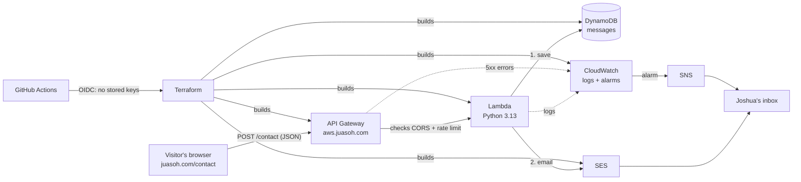

# The contact backend on AWS: how it works

The contact form on juasoh.com sends messages to an API Joshua built and runs on AWS, at **`https://aws.juasoh.com`**. This guide explains every piece: what it does, why it's there, what it costs, and how to set it up. It's written so you can explain it in an interview.

## The 30-second version

> When someone submits the form, their browser sends the message to **API Gateway** at `aws.juasoh.com`. API Gateway checks the request (where it came from, how often) and hands it to a **Lambda** function. The function validates the message, **saves it to DynamoDB**, then **emails it to me through SES** with Reply-To set to the sender. **CloudWatch** watches for errors and emails me through **SNS** if anything breaks. Everything is defined in **Terraform** and deployed by a **GitHub Actions** pipeline that signs in to AWS with **OIDC**, so no AWS keys are stored anywhere.



## Where everything lives

| Path | What it is |
|---|---|
| `services/contact/handler.py` | The Lambda function: about 150 lines of Python. |
| `services/contact/test_handler.py` | 15 unit tests, run with fake DynamoDB and SES, so no AWS account is needed. |
| `infra/bootstrap/` | One-time setup you run by hand: the Terraform state bucket and the GitHub→AWS trust (OIDC). |
| `infra/contact/` | The backend itself, one file per concern: `api.tf`, `lambda.tf`, `storage_email.tf`, `domain.tf`, `monitoring.tf`. |
| `.github/workflows/contact-backend.yml` | The CI/CD pipeline. |
| `src/components/ContactForm.tsx` | The website side: posts to the API, with an email fallback. |

## Each AWS service, and why

### API Gateway (HTTP API): the front door
It gives the backend a public HTTPS address (`aws.juasoh.com`) and does the boring-but-important work before any code runs:
- **TLS (HTTPS):** with a free certificate from **ACM** (AWS Certificate Manager), and old TLS versions refused (`TLS_1_2`).
- **CORS:** browsers only let pages on `juasoh.com`, `www.juasoh.com` (and `localhost` for development) read the API's answers. API Gateway answers the browser's "preflight" check itself, so it never reaches the Lambda or costs anything.
- **Throttling:** at most 2 requests per second, with bursts of 5. A person sends one message; a bot hammering the form gets `429 Too Many Requests` and can't run up the bill.
- **Access logs:** one JSON line per request (IP, route, status, latency) in CloudWatch.

*Why an HTTP API, not a REST API?* It's the newer, simpler flavour, about 70% cheaper, and has everything this needs.

### Lambda: the code
`handler.py` runs only when a request arrives. You pay per request, not for a server sitting idle. On `POST /contact` it:
1. **Checks the honeypot:** a hidden field people never fill in. If a bot filled it, the function answers "success" (so the bot doesn't learn) and does nothing.
2. **Validates:** all fields required and trimmed, length limits, a sane email address, no line breaks in the name or subject. That last one blocks *email header injection*, where an attacker sneaks extra headers like `Bcc:` into the email.
3. **Saves to DynamoDB first, then emails.** If SES has a problem, the message is still safe. The failure is logged as `EMAIL_SEND_FAILED`, which triggers an alarm.
4. **Never leaks internals:** any unexpected error returns a generic 500, and the stack trace goes only to the logs.

Settings worth knowing: **Python 3.13**, **ARM (Graviton)** (about 20% cheaper than x86), **128 MB** memory (the minimum), a **10 s** timeout, and **X-Ray tracing** (a timing breakdown of every request: API Gateway → Lambda → DynamoDB/SES).

### DynamoDB: the record of every message
A NoSQL table with one item per message (`id`, name, email, subject, message, time, IP, user agent).
- **On-demand billing:** fractions of a cent per write; no capacity to manage.
- **Point-in-time recovery:** restore the table to any second in the last 35 days.
- **Deletion protection:** stops an accidental `terraform destroy` or console click from wiping it.

To read messages: AWS console → DynamoDB → Tables → `juasoh-contact-messages` → *Explore items*.

### SES (Simple Email Service): the notification email
Sends `[juasoh.com] <subject>` from `contact@juasoh.com` to your inbox, with **Reply-To set to the visitor**, so hitting Reply in your mail app writes back to them.
- **Domain verification (DKIM):** three DNS records prove you own `juasoh.com` and cryptographically sign each email, so it lands in the inbox rather than spam.
- **The sandbox:** new AWS accounts can only send *to* verified addresses. Every email goes to you, and your address is verified, so you **don't need production access**.

### IAM: least privilege
The Lambda's role can do exactly four things: `PutItem` on its one table (it can't read or delete messages), `SendEmail` from its two verified identities, write its own logs, and send X-Ray traces. If the code were ever compromised, that's all an attacker could do.

### CloudWatch + SNS: knowing when something breaks
Three alarms email you (after you confirm the SNS subscription):

| Alarm | Fires when |
|---|---|
| `juasoh-contact-lambda-errors` | The function crashed or timed out. |
| `juasoh-contact-api-5xx` | Visitors got a server error (and fell back to email). |
| `juasoh-contact-email-send-failed` | A message was saved but not emailed. A *log metric filter* turns `EMAIL_SEND_FAILED` log lines into a metric. |

"No traffic" counts as OK, so a quiet week doesn't page you. Logs are kept 30 days.

### AWS Budgets: no surprise bills
It emails you if the account's monthly bill passes 80% of $5, or is *forecast* to pass $5. It watches the whole account, which on a personal account is the safest net.

## Infrastructure as code (Terraform)

Everything above is defined in `infra/contact/*.tf`, so the whole backend can be reviewed in a PR, re-created from scratch, or destroyed with one command. Practices worth calling out:
- **Remote state with locking:** Terraform's record of what it built lives in a versioned, encrypted, private S3 bucket. `use_lockfile` makes it write a lock object while it runs, so two deploys can never collide (no DynamoDB lock table needed on Terraform 1.10+).
- **Pinned versions:** `.terraform.lock.hcl` pins the exact AWS provider build for Linux, Mac and Windows.
- **Default tags:** every resource is tagged `Project=juasoh`, `Stack=contact`, `ManagedBy=terraform`, so the console and bill can be filtered.
- **Security scanning:** Checkov checks the Terraform against more than a hundred AWS best-practice rules. The 21 rules that don't fit a small public contact form are skipped with a **written reason** next to the resource (for example, a VPC would cost about $32/month and add nothing). Explaining a skip is the professional way to handle a scanner finding, rather than silencing it.

## CI/CD (GitHub Actions)

`.github/workflows/contact-backend.yml` runs whenever `services/contact/` or `infra/contact/` changes:

| When | Job | What it does |
|---|---|---|
| Every PR and push | **Test and scan** | Lambda unit tests, `terraform fmt` and `validate`, and the Checkov scan. |
| Every PR | **Plan** | `terraform plan` against real AWS with a **read-only** role, posted as a PR comment so you see exactly what will change. |
| Merge to `main` | **Deploy** | Waits for **your approval** (the GitHub `production` environment), then `terraform apply` and a smoke test of `/health`. |

**OIDC instead of access keys.** GitHub gives each run a signed token saying which repo, branch and environment it is. AWS checks it against rules in `infra/bootstrap` and returns credentials that expire within the hour.
- **Pull requests** can only get the read-only plan role.
- **Only the approved `production` environment** can get the deploy role.

Nothing secret is stored in GitHub, so there's nothing to leak or rotate.

## What it costs

At portfolio traffic (a few messages a month), almost everything sits inside AWS's free tier:

| Service | Typical cost |
|---|---|
| API Gateway, Lambda, DynamoDB, SES, SNS, X-Ray | $0 at this volume (pennies even if the free tier has expired) |
| CloudWatch logs (30-day retention) | ~$0 |
| ACM certificate | Free |
| S3 state bucket | < $0.01 |
| **Total** | **≈ $0–1/month** |

The budget alert and the API throttling are there so this stays true.

## Setting it up (one time, about 30 minutes)

You need an AWS account and access to the Cloudflare dashboard for juasoh.com.

1. **Bootstrap** from [AWS CloudShell](https://console.aws.amazon.com/cloudshell) (a terminal in the AWS console that is already signed in to your account, in region **us-east-1**):
   ```bash
   # Install Terraform (HashiCorp's repo for Amazon Linux)
   sudo yum install -y yum-utils
   sudo yum-config-manager --add-repo https://rpm.releases.hashicorp.com/AmazonLinux/hashicorp.repo
   sudo yum -y install terraform

   git clone https://github.com/ctmadejosh/joshua-asoh-portfolio-website.git
   cd joshua-asoh-portfolio-website/infra/bootstrap
   terraform init
   terraform apply   # review the plan, then type "yes"
   ```
   It prints `TF_STATE_BUCKET`, `AWS_PLAN_ROLE_ARN` and `AWS_DEPLOY_ROLE_ARN`. CloudShell clears installed software between sessions, but keeps your home folder, including this folder's `terraform.tfstate`.
2. **GitHub settings** (in the repo):
   - **Variables:** under *Settings → Secrets and variables → Actions → Variables*, add the three values above, plus `CONTACT_RECIPIENT_EMAIL` and `CONTACT_ALERT_EMAIL` (your email).
   - **Environment:** under *Settings → Environments*, create **`production`** and add yourself as a **required reviewer**.
3. **First deploy:** re-run the `contact-backend` workflow on `main` (*Actions → contact-backend → Run workflow*) and approve it. The *Show outputs* step lists the DNS records to add.
4. **Verify:**
   - **Cloudflare DNS:** add each record from the output under *juasoh.com → DNS*, with **Proxy status set to "DNS only" (grey cloud)**. AWS has to see these records directly.
   - **Two emails:** click the link in the **SES verification email** (to your inbox) and the **SNS subscription confirmation**.
5. **Attach `aws.juasoh.com`:** set the repo variable `CONTACT_CUSTOM_DOMAIN_READY` to `true` and run the workflow again. It waits for the certificate, attaches the domain, switches off the default AWS URL, and prints one last CNAME (`aws.juasoh.com → d-xxxx.execute-api…`). Add it in Cloudflare (DNS only).
6. **Check it:**
   ```bash
   curl https://aws.juasoh.com/health
   ```
   That should print `{"ok": true}`. Then send yourself a message from juasoh.com/contact.

Until step 6 is done, the website's form simply falls back to opening the visitor's email app, so it's safe to deploy the website first.

## Running it locally
```bash
python -m unittest discover -s services/contact -v   # Lambda tests, no AWS needed
cd infra/contact && terraform init -backend=false && terraform validate
```
To try the website against the API before the custom domain exists, build with `VITE_CONTACT_API_URL=https://<id>.execute-api.us-east-1.amazonaws.com/contact`.

## Tearing it down
DynamoDB has deletion protection on purpose. To remove everything:
1. Set `deletion_protection_enabled = false` in `storage_email.tf` and apply.
2. Run `terraform destroy` in `infra/contact`.

The state bucket in `infra/bootstrap` has `prevent_destroy` for the same reason.

## Ideas for the next step
- **AWS WAF** in front of the API, with managed bot rules (about $5+/month; worth it only if spam appears).
- **Tighter deploy role:** replace the service-wide permissions with per-resource ARNs now that the resource names are known.
- **A CloudWatch dashboard** showing requests, errors and latency in one view.
- **Hosting the website itself on S3 + CloudFront**, built by the same pipeline.
